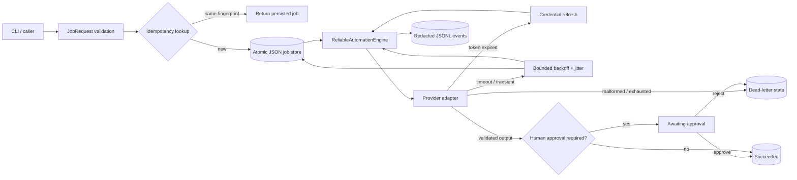

# Reliable AI Automation Proof

[](https://www.python.org/)
[](https://docs.python.org/3/library/)
[](LICENSE)

This is a small, runnable proof that useful AI automation is more than a prompt and a model call. It demonstrates the control plane around a provider: validated contracts, safe retries, idempotency, credential refresh, durable recovery, human review, failure isolation, and evidence-grade logs.

The runtime uses only the Python standard library. The included provider is deliberately scripted and secret-free, so every path is deterministic and safe to run locally. Replace its two-method adapter with an actual model or SaaS client without rewriting the orchestration engine.

## Run it

Prerequisite: Python 3.9 or newer.

```bash
git clone https://github.com/mykel1283nelson-hub/reliable-ai-automation-proof.git
cd reliable-ai-automation-proof

python3 -m unittest discover -s tests -v
python3 -m reliable_automation --state-dir runtime/demo demo all --reset
```

The demo runs seven scenarios:

| Scenario | What it proves | Expected final state |
|---|---|---|
| `success` | output waits for a named human decision | `succeeded` after approval |
| `retry` | transient failures use persisted exponential backoff | `succeeded` after 3 calls |
| `token-refresh` | an expired credential follows a distinct refresh path | `succeeded` after refresh |
| `malformed` | invalid provider output fails closed | `dead_letter` |
| `timeout` | deadline failures retry only within a bounded budget | `dead_letter` after 3 calls |
| `recovery` | a new engine instance resumes a previously persisted job | `succeeded` |
| `idempotency` | replaying the same request performs no duplicate provider call | `succeeded`, 1 provider call |

Run one scenario:

```bash
python3 -m reliable_automation --state-dir runtime/retry demo retry --reset
```

`--reset` only clears a directory previously created and marked by this demo. It
refuses non-empty, unmanaged directories, so a typo cannot recursively erase an
unrelated folder. A repeat run without `--reset` also refuses to overwrite stale
evidence instead of reporting misleading per-process call counts.

Inspect its proof:

```bash
python3 -m reliable_automation --state-dir runtime/retry list
find runtime/retry -maxdepth 3 -type f -print
```

A checked-in deterministic run is under [`evidence/sample-run`](evidence/sample-run). Its aggregate verdict is [`all-scenarios-summary.json`](evidence/sample-run/all-scenarios-summary.json).

## Architecture



### Durable state machine

```text
pending -> running -> awaiting_approval -> succeeded
                    \-> retry_wait -> running
                    \-> dead_letter
awaiting_approval  -> dead_letter (human rejection)
```

Every transition is written before the next potentially failing operation. Job files are written to a temporary file, flushed with `fsync`, and atomically installed with `os.replace`. A restart therefore reads a complete old state or a complete new state—never a half-written JSON record.

### Core invariants

1. **A key identifies one request forever.** The job ID is derived from the idempotency key, while a canonical request fingerprint detects key reuse with different data. Validated payloads are deeply immutable snapshots, so caller-side mutation cannot silently change that identity.
2. **Provider replay carries the same idempotency key.** A real adapter must propagate it to every side-effecting provider call.
3. **Unvalidated output cannot advance.** Provider content, confidence, and metadata are parsed into a strict `ProviderResult` before persistence.
4. **Retries are bounded and observable.** Exponential backoff is capped; jitter is injectable; the clock is injectable; retry intent is persisted before sleeping.
5. **Authentication failure is not a generic retry.** One explicit token-refresh budget is tracked separately from transient failures.
6. **Approval is a state, not a convention.** An output requiring review cannot reach `succeeded` without `approve(job_id, actor=...)`.
7. **Failures remain inspectable.** Terminal errors enter a named `dead_letter` state with a machine-readable code and full state history.
8. **Logs do not become a secret dump.** Common credential field names are recursively redacted before JSONL emission.

## CLI workflow

The CLI exposes the state transitions independently, which makes process restarts visible instead of hiding them inside one demo command.

```bash
# 1. Validate and persist work. This does not call the provider.
python3 -m reliable_automation --state-dir runtime/manual enqueue \
  --idempotency-key customer-42:weekly-summary:v1 \
  --objective "Prepare a concise weekly account summary" \
  --payload '{"customer_id":"example-42","dry_run":true}' \
  --timeout 5

# 2. Copy the job_id from cli.result, then run the adapter.
python3 -m reliable_automation --state-dir runtime/manual run JOB_ID \
  --provider-steps transient,success

# 3. A successful provider response stops at awaiting_approval.
python3 -m reliable_automation --state-dir runtime/manual approve JOB_ID \
  --actor reviewer@example \
  --note "Facts checked"

# 4. Inspect the durable record and transition history.
python3 -m reliable_automation --state-dir runtime/manual show JOB_ID
```

For rejection instead of approval:

```bash
python3 -m reliable_automation --state-dir runtime/manual reject JOB_ID \
  --actor reviewer@example \
  --reason "Source facts need revision"
```

## Provider adapter contract

Implement [`AutomationProvider`](reliable_automation/provider.py):

```python
class MyProvider:
    def generate(self, request: JobRequest, *, timeout_seconds: float):
        # Enforce timeout_seconds in the network client.
        # Propagate request.idempotency_key on side-effecting calls.
        return {
            "content": "validated output",
            "confidence": 0.91,
            "metadata": {"model": "provider-model-name"},
        }

    def refresh_token(self) -> None:
        # Refresh inside the credential boundary; never return a token.
        ...
```

Normalize vendor errors at the adapter boundary:

| Vendor condition | Raise |
|---|---|
| connection reset / HTTP 429 / HTTP 503 | `TransientProviderError` |
| enforced request deadline exceeded | `ProviderTimeout` |
| access token expired | `TokenExpired` |
| refresh failed | `TokenRefreshFailed` |
| any other known permanent error | another `ProviderError` subclass |

Timeout enforcement belongs in the network adapter because Python cannot safely terminate an arbitrary blocking thread. The engine passes the validated deadline and handles a normalized `ProviderTimeout`. Production adapters should use their HTTP client's connect/read/total timeout support; uncooperative code should be isolated in a killable worker process.

## Repository map

```text
reliable_automation/
  cli.py              commands and deterministic scenarios
  clock.py            SystemClock and zero-wait ManualClock
  engine.py           orchestration state machine and retry policy
  errors.py           typed failure taxonomy
  models.py           validated request/result/durable record contracts
  observability.py    redacted JSONL event logger
  provider.py         adapter Protocol and scripted proof provider
  storage.py          atomic filesystem job store
tests/                deterministic unit and integration tests
evidence/sample-run/  generated sample states, summaries, and JSONL logs
```

## What this proves—and what it does not

This repository proves orchestration behavior locally and deterministically. It does **not** claim that a specific third-party API is integrated, that a vendor honors idempotency, or that thread cancellation can stop arbitrary code. Those are adapter-level properties and need contract tests against the selected provider.

The engine is intentionally single-worker. Atomic persistence prevents torn records, but multi-process production use should add compare-and-swap storage or leases so two workers cannot claim the same pending job simultaneously.

## Design references

- Python documents [`os.replace`](https://docs.python.org/3/library/os.html#os.replace) as the atomic replacement primitive used by the store.
- Amazon's Builders' Library explains why reliable distributed calls need [timeouts, bounded retries, backoff, and jitter](https://aws.amazon.com/builders-library/timeouts-retries-and-backoff-with-jitter/).
- Amazon's Builders' Library also covers [making retries safe with idempotent APIs](https://aws.amazon.com/builders-library/making-retries-safe-with-idempotent-APIs/).

## License

MIT. See [`LICENSE`](LICENSE).
